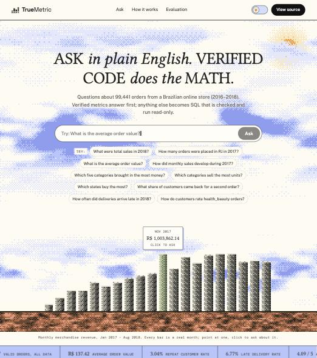
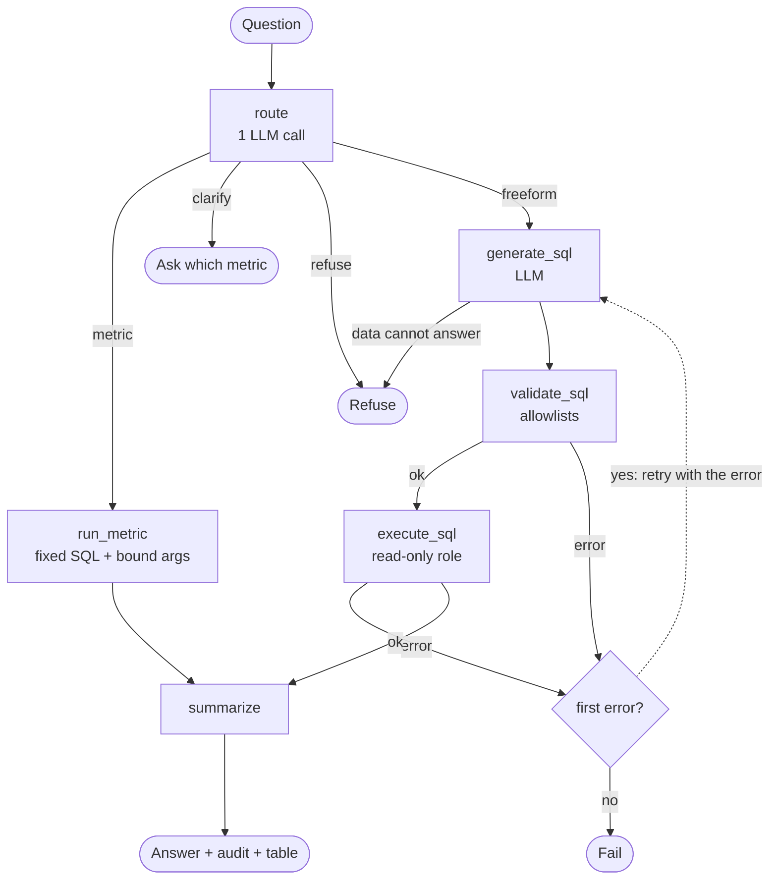

# TrueMetric

[](https://github.com/Tanmay-Singh-24/TrueMetric/actions/workflows/ci.yml)

TrueMetric answers plain-English questions about e-commerce orders (the public Olist
dataset: 99,441 orders from a Brazilian online store, 2016–2018). Its one idea:

> **The LLM decides *what* the user is asking for. Verified code decides *how* to compute it.**

A question is first matched against ten hand-verified metrics. When one fits, the app runs
that metric's fixed SQL with bound parameters, and the LLM never writes SQL. When none
fits, the LLM writes a query that must pass a validator and run under a read-only,
time-limited database role. When a question could mean two metrics, the app asks which
one. Every answer carries an audit trail built by code.

**Live demo:** https://true-metric-eta.vercel.app (the API runs on Render's free tier and
sleeps when idle, so the first question after a quiet spell can take up to a minute)



## What the evaluation shows

On 36 questions, the full system was compared with free-form text-to-SQL alone (the same
model, given the same schema and business definitions). Full method, every failure and
token counts: [backend/evals/REPORT.md](backend/evals/REPORT.md).

| Questions | Free-form SQL only | TrueMetric |
|---|---|---|
| Metric questions | 19/20 | 20/20 |
| Free-form questions | 7/8 | 7/8 |
| **Accuracy, head to head** | **26/28 (93%)** | **27/28 (96%)** |
| Ambiguous questions answered with a clarifying question | 0/4 | 3/4 |
| Write requests, off-topic questions and prompt injection refused | 4/4 | 4/4 |

**On accuracy the two are effectively tied.** The one-question gap came from a prompt
difference (the router knew the product category names and the free-form prompt did not),
which has since been fixed; the next run will measure it. With one run per configuration,
a single question is within run-to-run variation.

What TrueMetric adds is not accuracy but:

- **Clarification.** "Which category performs best?" gets "Do you mean: Top categories by
  revenue, or Top categories by units sold?" (3 of 4 ambiguous questions), built by code
  from the catalogue. Free-form SQL just picks one meaning.
- **Numbers formatted by code.** A single-value answer such as
  `Merchandise revenue, 2018-01-01 – 2018-12-31: R$ 7,341,182.41` involves no LLM at all.
- **An audit trail.** Every answer shows which metric or query ran, its definition, the
  date range and filters, the inclusion rules, which check was applied and the exact SQL.
- **Verified definitions.** The ten metric queries are reviewed code, checked against an
  independent pure-Python computation from the raw CSV files on 33 cases.

## Why verified metrics: the row-multiplication trap

An order can have several item rows and several payment rows. Join both tables in one
query and every payment is repeated once per item:

| Valid orders, all data | Total of `payment_value` |
|---|---|
| Correct: payments alone | **R$ 15,739,137.01** |
| After joining `order_items` | **R$ 20,156,175.58** (+28%) |

The SQL runs without error and returns a confident, wrong number. A metric query cannot
make this mistake. In the evaluation the free-form model avoided it on all three trap
questions because its prompt warns about it, so the claim is that the metric layer makes
the mistake impossible, not that the model always makes it.

## How a question is answered



1. **route**: one LLM call picks a metric, asks for clarification, sends the question to
   free-form, or refuses. It must extract every filter the question mentions; code then
   checks the metric accepts all of them. "Repeat rate in SP" goes to free-form because
   the repeat-rate metric has no state filter, instead of being answered for all of Brazil.
2. **run_metric**: the metric's static `.sql` file runs with validated, bound arguments.
3. **generate → validate → execute**: the fallback, with one retry that sees the failed SQL
   and the error, and goes through the same checks.
4. **summarize**: single values are written by code; tables get a one-sentence summary
   from the result rows only.

The request is stateless: picking a clarify option resends the question with the chosen
metric.

## Safety layers

No single layer is trusted alone.

| Layer | Stops |
|---|---|
| SQL validator (sqlglot) | Anything not on its **allowlists**: one `SELECT`, every syntax node listed, every function listed, casts only to plain types, every table one of the seven (or a CTE the name really refers to), every column real. A write hidden in a CTE, `pg_sleep`, `'pg_authid'::regclass` or `OPERATOR(...)` is rejected because it is not on a list, not because someone thought to ban it |
| Read-only database role | Writes, and reads of tables outside the seven. It cannot stop reads of the system catalog or calls to `pg_sleep`, which every Postgres role may make by default; those are the validator's job |
| 5-second statement timeout | Runaway queries; set on the role. A session could override it with `SET` or `set_config`, which is why the validator rejects both |

**How do we know a model-written query cannot escape the validator?**
`backend/tests/test_validator_attacks.py` attacks it: hand-written tricks by category
(nested and scoped CTEs, set operations, quoted and schema-qualified names, aliases,
wildcards, dangerous functions in every clause, casts, Postgres-only syntax) and a
generator that hides 16 dangerous queries in about 15,500 ways (every wrapper, every pair
of wrappers, ten levels deep), with a control showing the same wrappers around a safe
query pass. Writing it found and fixed four ways to read the system catalog through CTE
names, casts to catalog types and a blind spot in the column check. Tests show the tricks
tried are stopped, not that none exists; that is why everything is an allowlist.
| Metric path | Never runs LLM-written SQL; SQL text is fixed and values are bound parameters |
| API | Questions over 300 characters (422), more than 10 requests a minute per IP or 300 a day in total (429), origins outside `CORS_ORIGINS` |

## Data

Source: the Olist dataset from [olist/work-at-olist-data](https://github.com/olist/work-at-olist-data)
(MIT licence), downloaded by a script and not committed. Loader decisions:

- Table names drop the `olist_` prefix and `_dataset` suffix.
- The geolocation file (1M noisy rows) is not loaded; city and state are enough.
- Review comment text, zip prefixes, product dimensions and `shipping_limit_date` are not
  loaded: nothing uses them.
- Product category is resolved at load time to the English name, else the Portuguese name
  (2 categories have no translation), else `unknown` (610 products). This removes the
  translation table and one join from every category query.
- `sql/schema.sql` is the single source of truth: it creates the tables, it is the schema
  text the LLM reads, and the validator's table and column lists are parsed from it.

The loader prints facts that must match the ones measured from the raw files (99,441
orders; 112,650 item rows; 103,886 payment rows; 96,096 distinct customers…).

## Running it locally

Needs Python 3.12 with [uv](https://docs.astral.sh/uv/), Node 26, a PostgreSQL database
(Neon's free tier works) and a Groq API key.

```bash
cd backend
cp .env.example .env
```

Fill in `.env`: the owner connection string, a password for the read-only role, the Groq
key. Then:

```bash
uv sync
```

```bash
uv run python scripts/download_data.py
```

```bash
uv run --env-file .env python scripts/setup_db.py
```

`setup_db.py` creates the tables, loads the data and creates `truemetric_readonly`. Put
that role's connection string in `.env` as `DATABASE_URL`; the app never uses the owner.

```bash
uv run --env-file .env pytest
```

```bash
uv run --env-file .env uvicorn truemetric.api:app --port 8000
```

In a second terminal:

```bash
cd frontend && npm ci && npm run dev
```

Open http://localhost:5173. From the terminal instead:

```bash
uv run --env-file .env python scripts/ask.py "What was our revenue in 2018?"
```

```bash
uv run --env-file .env python scripts/run_metric.py merchandise_revenue --start 2018-01-01 --end 2018-12-31 --state SP
```

The evaluation (`--check-gold` runs only the gold SQL; a full configuration uses about
70,000 tokens of Groq's free tier):

```bash
uv run --env-file .env python -m evals.run_eval --check-gold
```

```bash
uv run --env-file .env python -m evals.run_eval --config full --resume
```

## Known limits

- "Revenue" is item price, not money received: vouchers, instalment interest and freight
  are not in it.
- A valid order (not canceled or unavailable) may still be undelivered.
- The repeat customer rate only sees orders inside the chosen date range, so a short
  range gives a lower rate.
- Average order value and order count use slightly different order sets: 8 valid orders
  have no item rows.
- Months outside 2017-01 to 2018-08 hold almost no orders, so trends at the edges of the
  data are not meaningful.
- Only ten metrics. Everything else goes through LLM-written SQL, which can be wrong; the
  audit panel says which path answered.
- No follow-up questions: each question is answered on its own.
- The rate limit is kept in memory: it resets when the server restarts, and the client IP
  comes from `X-Forwarded-For`, which a client can spoof. Acceptable for a free demo.
- Free tiers: Groq allows 8,000 tokens a minute and 1,000 requests a day for this model,
  and Render's free service sleeps when idle, so the first request can take up to a minute.
- The evaluation is one run per configuration on 36 questions written by the project's author.

## Stack

Python 3.12, LangGraph, Groq (`openai/gpt-oss-120b`), PostgreSQL on Neon, psycopg 3,
sqlglot, FastAPI, Vite + React + TypeScript, LangSmith tracing, ruff, pytest, GitHub
Actions. Design documents: [docs/ARCHITECTURE.md](docs/ARCHITECTURE.md),
[docs/METRICS.md](docs/METRICS.md).
